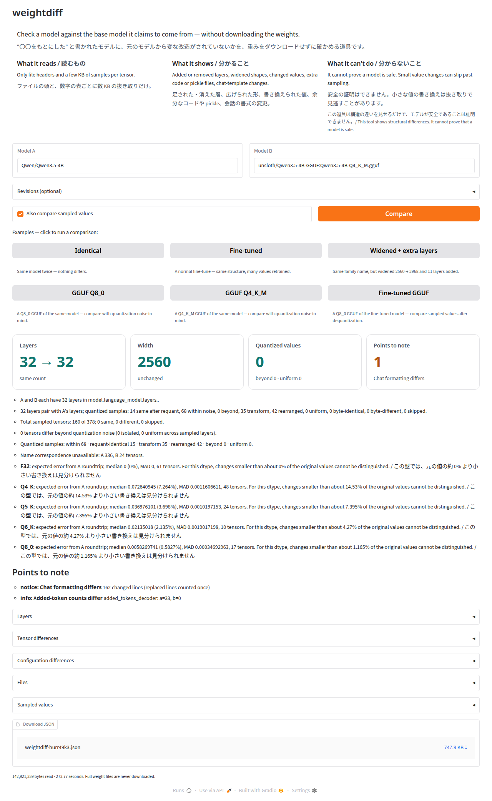

# weightdiff

**“〇〇をもとにした” と書かれたモデルに、元のモデルから変な改造がされていないかを、重みをダウンロードせずに確かめる道具です。**
Check a model against the base model it claims to come from — without downloading the weights. ([English](#english))



- **読むもの**: safetensors / GGUF のファイルの頭と、数字の表ごとの小さな抜き取りだけ（4B のモデルで数 MB〜数百 MB。重み全体は読みません）。モデルの読み込みも、リポジトリのコードの実行もしません。GPU も torch も要りません。
- **分かること**: 足された・消えた層、広げられた形、書き換えられた値、余分なコードや pickle、会話の書式の変更。量子化された GGUF とも、量子化の雑音を考えて比べます。
- **分からないこと**: 安全の証明はできません。小さな値の書き換えは抜き取りで見逃すことがあります。

## 使い方（手元で動かす）

```bash
python3.12 -m venv .venv && source .venv/bin/activate
pip install "weightdiff[ggml] @ git+https://github.com/kizuna-intelligence/weightdiff"

weightdiff-app          # ブラウザーで http://127.0.0.1:7860 を開く
# またはコマンドで
weightdiff Qwen/Qwen3.5-4B ccore/Qwen3.5-4B-3D-Coder --md report.md
weightdiff Qwen/Qwen3.5-4B unsloth/Qwen3.5-4B-GGUF:Qwen3.5-4B-Q4_K_M.gguf
```

`[ggml]` は K 系（Q4_K など）の量子化の雑音を正しく見積もるための追加です（llama-cpp-python）。無くても動きますが、その型は雑音の大きさを比べる相手から推定します。

## 例: 元の `Qwen/Qwen3.5-4B` と比べた結果

| 比べたモデル | 層 | 幅 | 抜き取った値の違い | 読んだ量 |
|---|---|---|---|---|
| `Qwen/Qwen3.5-4B`（同じ物） | 32 → 32 | 2560 | 0 / 160 | 1.9 MB |
| `ccore/Qwen3.5-4B-3D-Coder`（普通の fine-tune） | 32 → 32 | 2560 | 75 / 160 が違う | 2.0 MB |
| `divagr1925/Qwen3.5-4B-Qwenputer`（CPU を埋め込んだ物） | **32 → 43** | **2560 → 3968** | 違う 0。広げた行列の左上に元の値: 91 / 111 | 4.7 MB |
| `unsloth/Qwen3.5-4B-GGUF` Q8_0 | 32 → 32 | 2560 | 量子化の雑音より大きい違い 0 / 160 | 143 MB |
| `unsloth/Qwen3.5-4B-GGUF` Q4_K_M | 32 → 32 | 2560 | 量子化の雑音より大きい違い 0 / 160 | 143 MB |
| 3D Coder の Q8_0 GGUF | 32 → 32 | 2560 | 量子化の雑音より大きい違い 153 / 160 | 382 MB |

GGUF では、llama.cpp の変換でかかる書き換え（符号・指数・+1、ヘッドの並べ替え）を確かめてから「違う」と判定します。仕組みの詳しい説明は [docs/HOW_IT_WORKS.md](docs/HOW_IT_WORKS.md)。

## English

weightdiff compares a model with its claimed base model by reading only safetensors/GGUF headers and small samples of each tensor over HTTP Range requests. It never loads the model, never runs repository code, and needs no GPU or torch.

- **Shows:** added/removed layers, widened shapes, changed values, extra code or pickle files, chat-template changes. Quantized GGUF files are compared with the expected quantization noise of the base model, after checking known conversion rewrites (sign, exp, +1, head reordering).
- **Can't do:** it cannot prove a model is safe. Small value changes can slip past sampling.

```bash
pip install "weightdiff[ggml] @ git+https://github.com/kizuna-intelligence/weightdiff"
weightdiff-app      # open http://127.0.0.1:7860
weightdiff Qwen/Qwen3.5-4B unsloth/Qwen3.5-4B-GGUF:Qwen3.5-4B-Q4_K_M.gguf --md report.md
```

See the table above for example results and [docs/HOW_IT_WORKS.md](docs/HOW_IT_WORKS.md) for details.

## License

Apache-2.0

Quantized safetensors: bitsandbytes NF4/FP4/row-major INT8, GPTQ and AWQ GEMM
are compared using logical tensor shapes and bounded restored-value samples.
See [codec rules and supported layouts](docs/HOW_IT_WORKS.md#quantized-safetensors).
