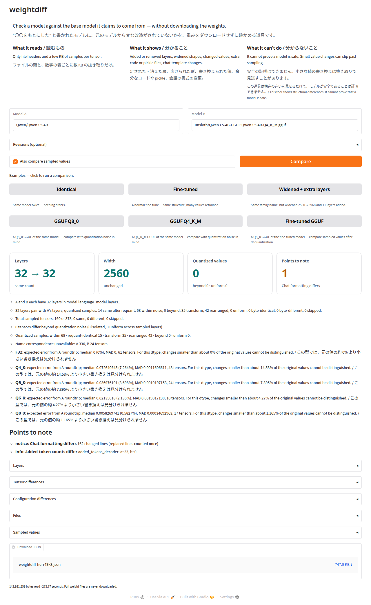

# weightdiff — how it works (詳しい仕組み)

“〇〇をもとにした” と書かれたモデルに、元のモデルから変な改造がされていないかを、重みをダウンロードせずに確かめる道具です。

- **読むもの**: ファイルの頭と、数字の表ごとの小さな抜き取りだけ（4B のモデルで数 MB〜数百 MB。重み全体は読みません）。
- **分かること**: 足された・消えた層、広げられた形、書き換えられた値、余分なコードや pickle、会話の書式の変更。
- **分からないこと**: 安全の証明はできません。小さな値の書き換えは抜き取りで見逃すことがあります。
  この道具は構造の違いを見せるだけで、モデルが安全であることは証明できません。/ This tool shows structural differences. It cannot prove that a model is safe.

2 つの Hugging Face モデル、手元のモデルフォルダ、GGUF ファイルの構造を比較します。
safetensors のヘッダーと小さな設定ファイルを読み、設定、層の指紋、テンソルの形・型、ファイル一覧の違いを表示します。
値の比較では、対応する名前と形が一致するテンソルから先頭 2,048 要素と、8,192 要素を超える場合は中央 2,048 要素を抜き取ります。
F32・F16・BF16 に対応し、異なる型は float32 に変換して丸めの範囲で比較します。同じ型はバイトの完全一致で比較します。
重みファイル全体はダウンロードせず、モデルのロードやリポジトリ内のコードの実行もしません。torch・GPU は不要です。

## インストールと使い方

Python 3.12 を推奨します（本体は Python 3.11 以上）。

```bash
python3.12 -m venv .venv
source .venv/bin/activate
pip install git+https://github.com/kizuna-intelligence/weightdiff
weightdiff-app
# ブラウザーで http://127.0.0.1:7860 を開く

weightdiff Qwen/Qwen3.5-4B ccore/Qwen3.5-4B-3D-Coder --md out/coder.md --json out/coder.json
weightdiff ./model-a ./model-b --no-sample
```

`weightdiff-app` は手元の `127.0.0.1` にだけ待ち受けるブラウザー画面を起動します。

`--rev-a` / `--rev-b` でリビジョンを指定できます。Hub のブランチは比較開始時にコミットに固定します。
`--max-tensors N` は抜き取り数の上限（既定 160）です。超える場合は名前順で均等に間引きます。
`--no-sample` で値の比較を省略します。非公開モデルの認証は Hugging Face の既存の認証設定を使います。
設定 JSON と会話テンプレートは 16 MiB、safetensors のヘッダーは 100 MiB、GGUF は 256 MiB が上限です。
HTTP Range の応答が 206 でない場合は本体を読みません。失敗は取得事情または skipped として表示します。
通信切れ、読み取りタイムアウト、HTTP 429・5xx は、2・4・8 秒待って最大 3 回再試行します。

## 3 つの例の結果

A はすべて `Qwen/Qwen3.5-4B`。以下は既存の `out/*_v3.md` の実測値です（実行ごとに時間は変わります）。
「テンソル差」は名前・形・型の差があるテンソル数で、抜き取った値の差とは別です。

| B | 言語層 A → B | 幅 A → B | テンソル差 | 抜き取り same / different | 左上区画で一致 / 対象 | 秒 | 読んだバイト数 |
| --- | --- | --- | ---: | --- | --- | ---: | ---: |
| `Qwen/Qwen3.5-4B` | 32 → 32 | 2560 → 2560 | 0 | 160 / 0 | — | 43.51 | 1,911,710 |
| `ccore/Qwen3.5-4B-3D-Coder` | 32 → 32 | 2560 → 2560 | 727 | 85 / 75 | — | 42.94 | 2,019,389 |
| `divagr1925/Qwen3.5-4B-Qwenputer` | 32 → 43 | 2560 → 3968 | 303 | 49 / 0 | 91 / 111 | 66.43 | 4,675,457 |

各比較の抜き取りは 160 個です。3D Coder と Qwenputer は別の並び `mtp.layers.` が 1 → 0。
Qwenputer の追加 11 層の位置は名前からは分かりません。左上区画で一致しなかった 20 個は、ほかの置き方を調べていません。
読み取り量はヘッダー・抜き取り・小ファイルの合計であり、キャッシュから読んだ小ファイルを含みます。



## 結果の読み方

- 同じ形の層が増えた場合、どこに増えたかは形から分かりません。位置は表示しません。
- 層数の異なる並びは指紋で比較し、その並びのテンソルを名前比較から除外します。
- same は同じ型なら抜き取ったバイトの一致、異なる型なら「抜き取った値は同じ（型の変換の丸めの範囲）」。全体の一致を意味しません。
- 接頭辞が違う並びも、指紋の重なりが小さい方の層数の 50% 以上なら組にします。層数が違う場合も、SequenceMatcher の equal 区間の層を抜き取ります。
- 形の指紋で組にできない並びは、テンソル名だけの指紋で同じ手順を試し、「名前で組（形が違う）」と表示します。幅が違う場合も対応した層を比べます。名前の指紋が既存と同じ追加層の位置は表示しません。
- 対応するテンソルの軸の大きさの変化を、テンソル数の多い順に最大 3 つ表示します。片側だけの `text_config.k` と反対側だけの `k` は同じ鍵として比較します。
- B の全軸が A 以上で少なくとも 1 軸が広いテンソルも、上限 160 個の対象です。2 次元は A の先頭・中央・最後の行全体と B の同じ行の先頭区画を読みます。1 次元は A 全体（8,192 要素を超えたら先頭と中央 2,048 要素）、3 次元以上は skipped です。
- `embedded_top_left` は抜き取った左上区画の一致です。`not_top_left` は「左上の区画には見つからない（ほかの置き方は調べていない）」を意味します。行全体の取得は通常の 2,048 要素の窓より長くなる場合があります。
- 層の外の名前には接頭辞の対応を当て、「名前の場所が変わった」テンソル数を表示します。並列取得は 16、型の比較対象外は skipped です。
- different は「値が違う（書き換えられている）」。用途や意図の判定はしません。
- `.bin` などの形式、Python ファイル・`auto_map`、会話書式・語彙の変化を気をつける点として表示します。
- 読んだバイト数はヘッダー・抜き取り・小ファイルの実測合計です。キャッシュから読んだ小ファイルを含み、HTTP のヘッダーと Hub API 一覧の通信量は含みません。

例: `Qwen/Qwen3.5-4B` 同士、`Qwen/Qwen3.5-4B` と `ccore/Qwen3.5-4B-3D-Coder`、
`Qwen/Qwen3.5-4B` と `divagr1925/Qwen3.5-4B-Qwenputer`。

## GGUF との比較

HF の GGUF は `repo_id:path/to/file.gguf`、手元の物は `.gguf` のパスを指定します。
`-00001-of-0000N.gguf` 形式の分割ファイルは、同名の全シャードの頭を読みます。
GGUF のヘッダーは 1 MiB から必要に応じて倍に増やし、メタデータとテンソル一覧だけを解きます。
gguf-py のアーキテクチャ別の名前対応を使い、対応しない名前は数と一覧に残します。
GGUF 同士は元の名前で比べます。形の違いを自動で補正しません。

```bash
weightdiff Qwen/Qwen3.5-4B unsloth/Qwen3.5-4B-GGUF:Qwen3.5-4B-Q8_0.gguf --md out/q8.md --json out/q8.json
weightdiff ./model-a ./model-b-Q4_K_M.gguf
weightdiff ./model-Q8_0.gguf ./model-Q4_K_M.gguf
```

量子化ブロックの境目に合わせて先頭・中央の各 2,048 要素を読み、NumPy で float32 に戻します。
量子化を含む比較では同じ形のテンソルが対象です。広げられた量子化テンソルの左上比較は skipped にします。

- `same_after_requant`: 元の浮動小数の抜き取りを同じ型で量子化し直したバイトと一致。
- 雑音の床 `e_exp` は、A の抜き取りを B の型で量子化して戻した相対誤差です。`e = ‖deq(B) − A‖ / ‖A‖` が閾値以下なら `within_quant_noise`。閾値は `e_exp > 0` なら `max(2 × e_exp, e_exp + 0.005)`、`e_exp == 0` なら `1e-5` です。
- 閾値を超えた場合は、順に `−x`・`x+1`・`x−1`・`−exp(x)`・`exp(x)`・正の A だけでの `log(x)` を照合します。一致すれば `same_after_transform`（変換（f）をすると同じ）。
- 2 次元では先頭・中央・末尾の行を全列読み、列を頭の大きさのまとまりに分け、先頭行で各 B のまとまりに最小相対誤差の A のまとまりを対応させます。同じ A を 2 回選んだら失敗です。まとまりの大きさは config の head_dim・linear_key_head_dim・linear_value_head_dim、GGUF の ssm.state_size などの実在する値を使い、無ければ 64・128・256 を試します。この 1 つの並べ替えを他の行にも同じように当てて照合します。外れ、A のテンソルが 32 MiB 以下なら A だけを全体読みし、B の各行と列の順序を保ったまま一致する、互いに異なる A 行を探します。各変換 f を A に施してからも同じ検証を行います。一致すれば `rearranged`（並べ替えると同じ（変換のときの並べ替えの可能性））とし、f と並べ替えの種類を表に出します。1 次元のみソート後の値を比較し、閾値は最大 `1e-5` です。全体読みを含む追加の通信量も読んだバイト数に含みます。
- それでも閾値を超える物が `beyond_quant_noise` です。
- `systematic`: 同じ種類の名前で**抜き取った層が 3 つ以上**あり、その全部が beyond、e の MAD/中央値 < 0.2。「抜き取った全部の層で同じように違う（学習し直した、または未知の変換）」を表示し、beyond と合わせて札の違いの数に含めます（beyond B · uniform S）。抜き取らなかった層は推測しません。
- 同じ型の GGUF 同士は抜き取ったブロックの完全一致（`same` / `different`）。異なる型は両方を戻し、両方の型の大きい雑音の床を使います。GGUF が A、浮動小数が B の場合は浮動小数側を較正の基準にします。
- gguf-py が戻せない型、非有限値、元がゼロで相手が非ゼロの抜き取り、取得失敗は、型名や事情を付けて skipped にします。

F16・BF16・Q4_0・Q4_1・Q5_0・Q5_1・Q8_0・TQ1_0・TQ2_0・MXFP4 は gguf-py で量子化します。
K 系・IQ 系の較正には任意の追加依存を入れられます（検証版 `llama-cpp-python 0.3.23`、CPU の libggml を ctypes で呼びます）。

```bash
pip install "weightdiff[ggml] @ git+https://github.com/kizuna-intelligence/weightdiff"
```

**imatrix は使いません。そのため予想誤差は大きめに出ることがあり、見逃し側に寄ります。**
追加依存が無い・型が未対応・libggml が imatrix を必須とする IQ 型の場合は、その型だけ B 自身の e の中央値と MAD に戻します。
この場合だけ `e > 中央値 + 6 × MAD` かつ `e > 中央値 × 2` で beyond とし、画面と報告に
「この型の雑音の床は B 自身から推定（全体を一様に変えた学習は見分けられません）」と理由を明記します。

画面と報告には型ごとの**予想誤差の中央値**と「元の値の約 ◯% より小さい書き換えは見分けられません」（`e_exp` の中央値 × 200%）を表示します。
B から推定する型は、その旨を表示して観測誤差の中央値を使います。抜き取りの上限は量子化・非量子化を合わせて既定 160 個です。

## 構成と開発

`domain/` は純粋な比較だけ、`external/` はデータ取得とファイル形式の解読を担当し、相互に import しません。
`application/` が収集・CLI・レポート・Gradio をつなぎます。
試験は NumPy・safetensors・gguf-py で小さなファイルを生成し、ネットを使いません。

```bash
pip install -e '.[test]'
pytest --basetemp=out/pytest-tmp
weightdiff-app
```

## ライセンス

[Apache-2.0](LICENSE)。

## English

Check a model against the base model it claims to come from — without downloading the weights.

- **What it reads**: Only file headers and small samples per tensor (a few MB to a few hundred MB for a 4B model; never the full weights).
- **What it shows**: Added or removed layers, widened shapes, changed values, extra code or pickle files, chat-template changes.
- **What it can't do**: It cannot prove a model is safe. Small value changes can slip past sampling.
  This tool shows structural differences. It cannot prove that a model is safe.

Compare two Hugging Face models or local model folders using safetensors headers,
small configuration files, and bounded byte samples. No model is loaded, no repository
code executes, and no full weight file is downloaded. No torch or GPU is required.

After publication, install with:

```bash
pip install git+https://github.com/kizuna-intelligence/weightdiff
```

Run `weightdiff-app`, then open http://127.0.0.1:7860 in your browser.
The UI binds to localhost. The table above records the three original example comparisons.
The screenshot shows the Qwenputer comparison.

Use `weightdiff A B --md out/report.md --json out/report.json`. Optional revisions:
`--rev-a R --rev-b R`. Disable sampling with `--no-sample`, or set its limit with
`--max-tensors N` (default 160, evenly subsampled in name order).

Reports show configuration differences, independent layer stacks and their shape
fingerprints, changed tensor metadata, sampled values, file differences, and points
to note. Added layers with an existing fingerprint have unknown positions. Tensors
in stacks whose layer counts differ are excluded from name comparison. Identical
samples do not imply identical weights. Failed reads and unsupported dtypes are explicitly skipped.
Connection failures, incomplete responses, read timeouts and HTTP 429/5xx retry up to
three times, waiting 2, 4 and 8 seconds.
Stacks with different prefixes are paired by fingerprint multiset overlap (at least 50%
of the smaller stack); equal layer intervals remain eligible for sampling even when
layer counts differ. Prefix mappings also match tensors outside layers.
Unmatched stacks fall back to sorted tensor-name fingerprints, with the same overlap
threshold and greedy pairing. Reports label these as paired by names (shapes differ).
The top three axis-size changes count each tensor once per size transition.
Exclusive `text_config.k` and `k` configuration keys are compared as aliases.
Samples use the first 2,048 elements and middle 2,048 for tensors over 8,192 elements.
F32/F16/BF16 pairs use float32 tolerance `2^-7 * max(abs(a), abs(b)) + 2^-14`;
identical dtypes use exact bytes. Requests run with 16 workers.
Wider B tensors share the 160-tensor limit: 2D comparisons read full A-width rows at
row 0, the middle A row and the last A row, at identical row indices in B. 1D reads
all A elements up to 8,192, otherwise first and middle 2,048; 3D and higher are skipped.
`embedded_top_left` indicates matching sampled blocks; `not_top_left` means not found
in the top-left block (other placements have not been checked). Full-row ranges can
exceed the usual element-window byte length. Neither result proves full-tensor equality.

Read-byte totals include inspected headers, samples and small files, including cache
reads; HTTP headers and Hub API listings are excluded. Run `pytest --basetemp=out/pytest-tmp`
for offline tests. Run `weightdiff-app` for the local UI. License: Apache-2.0.

GGUF inputs accept `repo_id:path/to/file.gguf` or a local `.gguf` path, including split shards.
Only the header prefix (1 MiB, doubling up to 256 MiB) and block-aligned samples are read.
HF tensor names are matched using gguf-py's architecture map; unmapped names remain visible.
Requantized byte matches are `same_after_requant`. Expected noise comes from quantizing
and restoring A's samples to B's dtype. The threshold is `max(2 * e_exp, e_exp + 0.005)`
when `e_exp > 0`, and `1e-5` when `e_exp == 0`.
Above-threshold values are checked against −x, x+1, x−1, −exp(x), exp(x), and log(x)
(on positive A entries). Matches are `same_after_transform`, with the function recorded.
For 2D tensors, columns are split into intact head-sized groups. Each B group in the
first row selects the A group with minimum unsorted relative error; reusing an A group
fails. Sizes come from actual config/GGUF head dimensions (head_dim, linear_key_head_dim,
linear_value_head_dim, ssm.state_size, etc.), or 64/128/256 when absent. The same group
permutation is checked unchanged against the middle and last rows. A tensors of at most 32 MiB may then be read
in full to find distinct matching rows without sorting their values. Each element transform
is also tried before these checks. Only 1D tensors compare sorted values, at a threshold
of at most `1e-5`. Matches are `rearranged` (possible conversion permutation), with the
transform and permutation kind recorded; additional bytes count toward measured reads.
Other samples are `beyond_quant_noise`. At least three sampled layers of a name kind,
all beyond with error MAD/median < 0.2, are `systematic`: uniform differences across
sampled layers (retraining or an unknown transform). Both beyond and systematic count
as differences in the Quantized values card, whose detail is `beyond B · uniform S`.
Unsampled layers are not inferred. These classifications do not prove unchanged weights.

Install optional CPU calibration with
`pip install "weightdiff[ggml] @ git+https://github.com/kizuna-intelligence/weightdiff"`
(tested with llama-cpp-python 0.3.23). K/IQ roundtrips use libggml's quantizer and to_float
through ctypes. **No importance matrix is used; errors can be conservative, favoring missed
changes.** Missing/unsupported native encoders, including IQ types requiring an importance
matrix, fall back per dtype to B's median/MAD, explicitly warning that uniformly retrained
values cannot be distinguished. Fallback beyond requires both median + 6 MAD and twice
median to be exceeded. Reports show the expected error median and the approximate
undetectable change size (twice that median). Same-typed GGUF pairs use exact sampled
bytes; different types use the larger floor. Reverse float/GGUF comparisons calibrate
against the floating-point side. Unsupported decoders or shapes are skipped explicitly.
